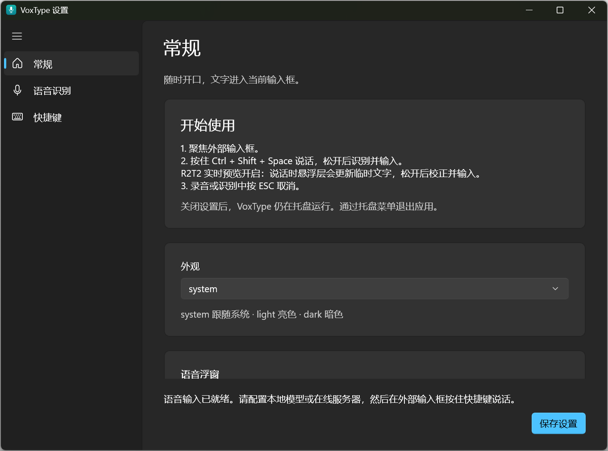

<div align="center">

**English** · [中文](./README.zh.md)


# VoxType

**Hold to speak. Release to type. Stay in your flow.**


[](https://github.com/hongjiapeng/VoxType/releases)

[Quick start](#quick-start) · [Speech engines](#choose-your-speech-engine) · [Downloads](https://github.com/hongjiapeng/VoxType/releases) · [Development](#development-and-releases)

</div>

VoxType is a global voice typing tool for Windows 11. Focus a text field in your editor, chat app, or form, hold **Ctrl + Shift + Space** to speak, then release to transcribe and insert the result. Press **Esc** to cancel.

It lives in the system tray and needs no VoxType account. Run Whisper offline, connect to R2T2 on your PC or LAN, or use your own OpenAI-compatible transcription endpoint.

## See words appear as you speak

With R2T2, the floating overlay shows a draft transcript while you hold the shortcut. Release it to transcribe the full recording and insert the final text into your app.

<p align="center">
  
</p>

Draft words can change as more context arrives. Live preview is available with R2T2; Whisper and OpenAI Compatible transcribe after you release the shortcut. This image is a static UI demonstration. See [verification and current limits](#verification-and-current-limits) for the scope of testing.

### Move it where you need it

Drag the handle, waveform, or status text. VoxType remembers the position and tries to avoid the input area. Enable **Keep on desktop** to retain a small microphone entry between sessions; it records only after you click it.

<p align="center">
  
</p>

## What it does

| Feature | Capability |
|---|---|
| **Global push to talk** | Hold Ctrl + Shift + Space, or choose your own shortcut; Esc cancels |
| **Speech engines** | Local Whisper, local/LAN R2T2, and OpenAI Compatible |
| **Live draft text** | R2T2 previews during recording, then corrects the result from the full audio |
| **Floating controls** | Waveform, progress, retry, direct dragging, position memory, input avoidance, and optional desktop entry |
| **Local inference devices** | Separate CPU / Vulkan choices for Whisper and local R2T2 |
| **Model management** | Download, import, verify, and delete Whisper base; prepare and launch local R2T2 resources |
| **Text delivery** | Tries to restore the original input window and paste; retains the result for manual copying when delivery fails |

## Quick start

1. Download the Windows x64 installer or portable ZIP from [GitHub Releases](https://github.com/hongjiapeng/VoxType/releases/tag/v0.1.1).
2. Install VoxType, or extract the **entire** ZIP and run `VoxType.App.exe`. Open settings from the tray, or run `VoxType.App.exe --settings`.
3. Choose a speech engine under **Speech recognition (语音识别)**. For offline use, select Whisper, download a model, choose **Use this model (使用此模型)**, and save.
4. Focus your target text field, hold **Ctrl + Shift + Space**, speak, and release.
5. Press **Esc** to cancel. Closing settings keeps VoxType in the tray; choose **Exit (退出)** from the tray menu to stop it.

The installer runs per user under `%LOCALAPPDATA%\Programs\VoxType` without administrator rights. Both packages include .NET and Windows App SDK runtimes. Speech models are downloaded or imported separately. The current application UI is in Chinese.

## Choose your speech engine

The shared-library local mode and separate server package below are source changes for the next release. Published v0.1.1 still bundles the server.

| Engine | Best for | Setup |
|---|---|---|
| **Local Whisper** | Offline transcription on your PC | Download/import multilingual Whisper **base GGML**, about 148 MB; choose CPU or Vulkan |
| **R2T2 Local** | Offline inference with live previews | Prepare about 1.63 GiB of GGUF models in settings, then enable the CPU / Vulkan engine |
| **R2T2 Server** | Another device or separately deployed server | Base URL, model alias and optional API key; deployers use the separate server ZIP |
| **OpenAI Compatible** | An existing transcription service | Set a Base URL, model, and optional API key; the service must support `/v1/audio/transcriptions` |

**Whisper:** Choose Hugging Face or the explicitly labeled HF-Mirror source. Downloads and imports are checked by size and SHA-256. The managed model is multilingual base GGML; `base.en` and GGUF are not supported by this provider. Restart VoxType after changing the device once Whisper has loaded.

**R2T2:** Local mode calls the shared library and starts one background llama-server process. Server mode connects to an independent HTTP adapter, available as an optional ZIP. Existing server settings are preserved; select Local explicitly to use the built-in engine. Live preview repeatedly transcribes snapshots of the recording; draft words may be revised, and latency depends on the device and recording length. Only the final result is inserted. See the [deployment guide (Chinese)](docs/r2t2-server.md).

**Compatible services:** Remote OpenAI-compatible endpoints require HTTPS; HTTP is allowed only for loopback addresses. R2T2 LAN mode has separate address validation and authentication requirements.

Detailed model, device, and session behavior is documented in the [usage guide (Chinese)](docs/usage.md).

## Requirements

| Requirement | Notes |
|---|---|
| Windows | Windows 11 x64, an available microphone, and desktop microphone access enabled |
| Desktop runtimes | .NET 10 and Windows App SDK are included in the release packages |
| Local Whisper | CPU support for AVX, AVX2, FMA, and F16C; x64 Visual C++ 2022 Redistributable |
| Vulkan | A compatible GPU and driver; switch to CPU if unsupported |
| Local R2T2 preparation/startup | Model storage and several GiB of available memory; local mode requires no HTTP adapter, PowerShell or .NET SDK |

Preview packages are unsigned, so Windows may show an unverified publisher. VoxType does not install trust certificates or change Windows security policy.

## Troubleshooting

<details>
<summary><strong>Text was recognized but did not appear in my app</strong></summary>

Focus the text field before using the shortcut. Delivery can fail if the target closes, is minimized, changes focus, runs at a higher privilege level, or rejects pasting. Copy the latest result from settings and paste manually. Avoid shortcuts already used by Windows or your editor.

</details>

<details>
<summary><strong>No sound, a short recording, or a model-loading error</strong></summary>

Check Windows microphone permissions and the default recording device. Recordings must be at least 250 milliseconds and are limited to 60 seconds. Download/import a Whisper model before use. If Vulkan fails to load, select CPU and restart. VoxType does not automatically download resources at startup or during recording.

</details>

<details>
<summary><strong>R2T2 preparation or startup failed</strong></summary>

Prepare resources in settings, then start after verification completes. Settings show progress and errors and allow stopping/cancellation. Default ports are 8272 / 8273; stop old terminal services with Ctrl+C before upgrading. If Vulkan fails, stop and select cpu before retrying. Verified resources are reused. The original v0.1.0 package compiled the service at startup and omitted build settings; use a complete fixed build. See the [R2T2 guide (Chinese)](docs/r2t2-server.md).

</details>

<details>
<summary><strong>Where are settings and models? Does uninstalling remove them?</strong></summary>

Installer and portable builds use `%LOCALAPPDATA%\VoxType`. Uninstalling or deleting the portable folder retains settings and models. The older MSIX development build uses a virtualized package directory; check the actual path shown in settings. Switching distribution formats does not migrate data automatically.

</details>

## Data and privacy

- Audio and the latest transcript stay in memory. VoxType does not create audio recordings or transcription history on disk.
- Whisper runs locally. R2T2 and online recognition send audio to the endpoint you configure. Models download only when you request preparation/download.
- Saved API keys are encrypted with Windows DPAPI CurrentUser, rather than stored in plaintext. This does not protect against malicious software running as the same user.
- Insertion uses the clipboard and Ctrl+V. VoxType attempts to restore the previous clipboard while preserving anything newly copied; complex formats, clipboard contention, and slow apps may affect restoration.

See the [usage guide (Chinese)](docs/usage.md) for paths, clipboard behavior, and service restrictions.

## Settings and personalization

<details>
<summary><strong>View the settings workspace</strong></summary>

Choose your speech engine, shortcut, light/dark theme, and desktop overlay behavior.

<p align="center">
  
</p>

</details>

## Development and releases

Development requires the .NET 10 SDK constrained by [`global.json`](global.json), Visual Studio's WinUI tooling, the Windows SDK, and WinApp CLI.

```powershell
dotnet restore VoxType.slnx -p:Platform=x64
dotnet build VoxType.slnx -p:Platform=x64
dotnet test tests/VoxType.Tests/VoxType.Tests.csproj -p:Platform=x64
winapp run src/VoxType.App/VoxType.App.csproj --arch x64 -p Platform=x64 --args '--settings'
```

Build the installer and portable ZIP with PowerShell 7 and Inno Setup 6:

```powershell
./scripts/build-release.ps1 -Version 0.1.1
```

The script runs Release tests, publishes the self-contained x64 app, verifies required content, and generates an installer, ZIP, build information, and SHA-256 manifest. See the [release guide (Chinese)](docs/releases.md).

## Verification and current limits

This is an initial preview. Automated regression checks, overlay UI checks, and some real Whisper / R2T2 model checks have been completed. Microphone behavior, shortcut conflicts, and text delivery across apps still need validation on each device. Passing automated tests does not guarantee that every app will accept pasting.

Detailed verification documents are currently in Chinese:

- [Verification records](docs/verification.md)
- [Manual acceptance checklist](docs/manual-acceptance.md)
- [Overlay interaction and test scope](docs/overlay-interaction.md)
- [R2T2 real-model verification](docs/r2t2-verification.md)

## Acknowledgements

VoxType's push-to-talk and direct text insertion experience was inspired in part by [VoiceInput](https://github.com/yetone/voice-input-dist), a macOS menu bar speech-to-text app. This is product inspiration; VoxType's implementation is independent.

## License and third-party components

See [third-party notices](docs/third-party-notices.md) for dependencies and model sources. A license for the project itself has not yet been selected.
