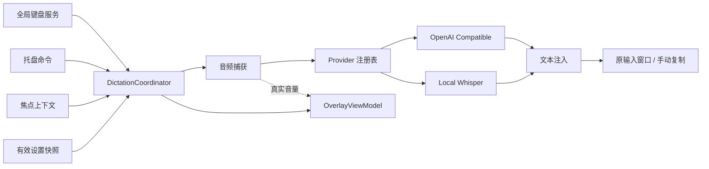

# Design

## Context

动机与功能边界见 [proposal.md](proposal.md)，行为合同见本目录 `specs/` 下的 7 个 capability。当前变更是待审核设计，以下结构、接口和行为均为拟实现方案，不是已有代码。

2026-10-02 检查结果：

| 项目 | 实际观察 |
| --- | --- |
| 工作仓库 | `C:\Users\HP\Documents\ChatGPT\VoxType`，初始仅 `.git`，master 无提交，无 remote |
| 另一个授权路径 | `D:\30_Code\Personal\OpenSource\VoxType` 为空，本轮不在该目录写入 |
| 原工程与约束 | 无 solution / project / 源码 / 测试 / 包版本 / AGENTS.md；不能声称沿用既有技术栈 |
| .NET | 已安装 x64 SDK 10.0.301，另有 9.0.102；尚未验证 WinUI 工程构建环境 |
| Node 与 OpenSpec | Node 24.16.0；OpenSpec 全局 CLI 从 1.8.0 更新到 npm latest 1.14.0；本仓库已初始化 spec-driven、中文、Codex core profile |
| UI 工具 | WinApp CLI 0.7.0；已查询 NavigationView 与 ProgressRing 官方 Gallery 示例；因没有恢复后的工程，本轮无法做项目引用范围内的 API 校验 |
| 视觉参考 | 用户尚未提供参考图；按文字中的 Windows 11 Fluent、小型底部浮层设计，后续图仅用于视觉微调 |

设计依据来自 Windows 官方 API 文档；开源项目用于核对产品和服务分离思路。下文明确区分系统事实、方案选择和待执行验证。

## Goals / Non-Goals

**Goals:**

- 用三个生产工程清晰分离 UI、会话编排和平台实现，按用户六个阶段逐步构建。
- 普通桌面权限下，优先保证记事本和常见可粘贴文本框的重复完整链路；其他应用不兼容时保留结果并给出准确提示。
- 每个会话固定配置和目标，取消与退出后不执行迟到注入，原生资源生命周期明确。
- 原窗口恢复、剪贴板恢复和文字发送均有可验证的降级边界。

**Non-Goals:**

- 完整排除项见 proposal；不额外引入领域层、消息总线、后台服务器或插件发现。仅为当前支持的 base 模型提供用户主动触发的下载与安装管理。
- 不保证所有应用接受粘贴、不保证恢复光标位置、不跨安全桌面、不自动提权。
- 不以第一版为由改用 WPF / WinForms UI，也不要求 Native AOT、GPU 环境或生产 Store 证书。

## Decisions

### D1. 工程结构和依赖方向

拟建立下列工程。`VoxType.Core` 使用 `net10.0`，不引用 WinUI、NAudio 或 Win32；App / Infrastructure 使用兼容 Windows SDK 的 `net10.0-windows...`，只构建 x64。精确 Windows SDK / Windows App SDK 稳定版本由 Phase 1 官方模板与恢复结果锁定；最低支持 Windows 11，不把模板默认的 Windows 10 支持误报为产品承诺。

```text
src/
  VoxType.App/                 # WinUI、MVVM、composition root
    Views/                    # 三个设置页面
    ViewModels/               # Settings / Overlay
    Overlay/                  # OverlayWindow、WaveformControl、窗口生命周期
  VoxType.Core/               # 契约、DTO、验证、会话状态机
    Dictation/
    Audio/
    Hotkeys/
    Transcription/
    TextInjection/
    Settings/
  VoxType.Infrastructure/     # 替换具体 Provider 或平台实现
    Audio/
    Transcription/Whisper/
    Transcription/OpenAICompatible/
    Windows/Hotkey/
    Windows/ForegroundWindow/
    Windows/TextInjection/
    Windows/Tray/
    Settings/
tests/
  VoxType.Core.Tests/
  VoxType.Infrastructure.Tests/
```

App 引用 Core 和 Infrastructure；Infrastructure 只引用 Core。Core 暴露 `IAudioCaptureService`、`IGlobalHotkeyService`、`ITranscriptionProvider`、`ITextInjectionService`、`IFocusContextService`、`ISettingsStore` 和 `ISecretProtector`。托盘的原生实现不依赖 WinUI ViewModel，App 将托盘操作绑定到命令。通过构造器组合服务，不为三工程再新增 DI 专用工程。



选择原因：现有仓库为空，三工程足以实现替换和行为测试。单工程加大量 code-behind 虽能起步更快，会让键盘、音频、UI 线程和 Provider 生命周期耦合；再细分多层工程没有第一版收益。

### D2. 单会话编排与取消边界

Core 中的 `DictationCoordinator` 管理 `Idle → Starting → Listening → Stopping → Processing → Injecting → Completed / Failed → Idle`；取消进入 `Cancelling`，资源清理完成才允许下次实际录音。Overlay 只映射用户所需的四种视觉状态，Starting / Stopping 可显示短暂准备提示而非假 Listening 波形。

- 使用串行事件队列或等价的轻量同步机制处理 Start、Release、Cancel、AudioFault、ProviderCompleted；异步录音/HTTP/推理不持有长时间互斥锁。
- 每个会话有递增 ID、CTS、不可变设置快照、Provider lease 与 FocusContext。所有异步完成和隐藏定时器先比较会话 ID。
- Start 尚未完成便收到 Release，记录待停止，初始化成功后立即停止；初始化失败走统一清理，不能出现松键后才开始无限录音。
- ESC 可取消录音与识别。即使 Provider 忽略取消，也用会话 ID 和取消标志拒绝迟到结果。若原生推理仍运行，显示清理状态或忙碌提示，不并发复用同一上下文。
- 在注入提交点之前再次检查取消；进入实际 Ctrl+V 发送后不能可靠撤销已到达目标的文本，ESC 不声称能回滚已发送内容。
- 自动结束上限 60 秒；录音异常、锁屏或休眠取消并释放设备；识别中忙碌请求不排队保存第二段录音。
- 配置在 Start 固定。设置保存后下一次会话生效，当前 Provider 和 Hotkey 序列仍使用旧快照直至结束。

### D3. Push-to-talk：专用线程的 WH_KEYBOARD_LL

Windows 的 `RegisterHotKey` 通过 WM_HOTKEY 报告组合触发，没有完整 key-up 契约，因此不能独立承担本次 push-to-talk。选择 `WH_KEYBOARD_LL`，因为它能观察 key-down / key-up / syskey 消息，也能拦截默认 Ctrl + Win + F8 主键和自定义 Alt + Space 的系统菜单触发。[RegisterHotKey](https://learn.microsoft.com/en-us/windows/win32/api/winuser/nf-winuser-registerhotkey)

Hook 在线程自己的消息循环安装，回调只更新按键集合、判断组合、投递控制消息并立即返回；不录音、不等待、不调用 HTTP 或 Dispatcher 同步操作。托管委托保留强引用，关闭时 unhook 并停止消息循环。回调超时可能导致系统静默移除 Hook，故不能宣称安装一次就永久可靠。[LowLevelKeyboardProc](https://learn.microsoft.com/en-us/windows/win32/winmsg/lowlevelkeyboardproc)

组合匹配使用 Hook 消息维护的左右修饰键状态，忽略注入标志与自身标记的合成输入。修饰键先按，主键后按才触发；不回溯吞掉此前的普通 Space。精确匹配已配置修饰键，不让额外 Ctrl / Shift 的组合意外触发。主键或必要修饰键松开使组合解除时只结束一次，所有相关键释放后才能重新武装。重复 key-down 不再开始会话。

记录本次被吞掉的主键序列，并成对处理其重复和 key-up；普通修饰键事件保持正常传播。ESC 只在有可取消会话时接管并配对处理；其他按键走 CallNextHookEx。不同 Alt 释放顺序可能影响系统菜单和菜单栏状态，Phase 2 必须实测，不能把压住 Space 等同于已解决所有系统行为。

独立于回调的小型 watchdog 使用 `GetAsyncKeyState` 高位核对未被拦截的必要修饰键，并在必要修饰键丢失时取消。被拦截的主键和 ESC 不会更新 Windows 异步状态，必须保留 Hook 跟踪直到对应 key-up，不能因轮询未报告而清除、取消或丢失成对吞键。主键松开依赖 Hook；Hook 遗漏时仍有修饰键轮询、会话通知和 60 秒上限，不能宣称轮询可靠检测被拦截主键的物理状态。不能在 Hook 回调内读它来判断当前事件，因为状态更新时机不对。锁屏/休眠通过系统会话与电源通知清理。watchdog 不声称能够检测所有 Hook 静默移除；设置提供重新应用快捷键以重建 Hook。[GetAsyncKeyState](https://learn.microsoft.com/en-us/windows/win32/api/winuser/nf-winuser-getasynckeystate)

快捷键 MVP 编辑器支持 Alt / Ctrl / Shift / Win 加一个主键，默认 Ctrl + Win + F8；禁止 F12、ESC 主键、未知修饰位、仅修饰键和无修饰字符键。提示避开系统及常用编辑器组合。旧版本 1 默认 Alt + Space 自动迁移为版本 2 新默认；保留其他自定义组合、Provider、模型路径及原 DPAPI 密文，版本 2 中主动选择的 Alt + Space 不再被迁移。Hook 无法像 RegisterHotKey 一样完整枚举其他 Hook 的冲突，提示“可能被其他软件占用”并支持更换，不能显示未经验证的“无冲突”。Raw Input 可观察但不能直接抑制系统菜单，因此不作为这一版主要实现。

### D4. 独立 OverlayWindow，先设样式再显示

App 使用单独的 WinUI Window，初始化后保留并隐藏。取得 HWND 后设置 `WS_EX_NOACTIVATE | WS_EX_TOOLWINDOW`、清除 `WS_EX_APPWINDOW`，移除不需要的系统边框，配置 presenter 不可最大化/最小化，置顶。禁止首次显示路径调用 `Window.Activate()`；显示使用 `ShowWindow(SW_SHOWNOACTIVATE)` 或经核实可用的 `AppWindow.Show(false)`，搭配 `SetWindowPos(HWND_TOPMOST, ..., SWP_NOACTIVATE)`。每次显示/重定位均保持 no-activate。[扩展窗口样式](https://learn.microsoft.com/en-us/windows/win32/winmsg/extended-window-styles)、[SetWindowPos](https://learn.microsoft.com/en-us/windows/win32/api/winuser/nf-winuser-setwindowpos)

处理 WM_MOUSEACTIVATE 返回 MA_NOACTIVATE，允许托盘会话的结束按钮接收点击但不激活窗口。不得把 WS_EX_TRANSPARENT 当作通用的鼠标穿透或 no-activate 方案。[WM_MOUSEACTIVATE](https://learn.microsoft.com/en-us/windows/win32/inputdev/wm-mouseactivate)

默认 360 × 84 DIP，以目标屏幕工作区定位并换算 DPI，离任务栏上方留间距。圆角、轻量 Acrylic 和系统阴影尽力使用，透明关闭、失焦材质或高对比度情况下退回主题实色。独立 HWND 的阴影采用系统窗口机制；不假设 root Grid 的 ThemeShadow 能在桌面外部生成阴影。[系统材质](https://learn.microsoft.com/en-us/windows/apps/develop/ui/system-backdrops)

Listening 显示图标、文字、16 条最近真实 RMS 样本驱动的音量柱和本地/在线标识；Processing 移除音量柱并显示 ProgressRing。音量 UI 更新限制约 30 Hz，数据跨线程投递至 DispatcherQueue。正常发送短暂显示“已发送文本”约 650 毫秒，避免暗示验证了外部控件内容；错误约 3 秒，手动复制提示约 5 秒并保留设置入口。隐藏计时器绑定会话 ID。

在 Phase 1 以静态状态验证浮层布局和 HWND focus 不变；Phase 2 才接真实音量。参考图尚未提供不妨碍平台方案审核。

### D5. 目标窗口记录与尽力恢复

快捷键触发时，在录音与显示浮层前同步采样 `GetForegroundWindow` 和 `GetWindowThreadProcessId`，尽力取得 `GetGUIThreadInfo` 的 focus HWND，记录顶层 HWND、PID / TID、可读进程创建时间、可读焦点子 HWND、目标屏幕以及会话 ID，不记录窗口标题或输入内容。[GetForegroundWindow](https://learn.microsoft.com/en-us/windows/win32/api/winuser/nf-winuser-getforegroundwindow)、[GetGUIThreadInfo](https://learn.microsoft.com/en-us/windows/win32/api/winuser/nf-winuser-getguithreadinfo)

注入前验证 IsWindow、PID / 可读创建时间和有效焦点，排除自身窗口、Shell 菜单和安全桌面。若原窗口仍前台，检查可获得的焦点子窗口未改变。若不同，仅尝试一次 `SetForegroundWindow` 恢复原窗口，再重新读取并验证；失败或目标最小化、子焦点明显不同则回退。不得全局改 foreground lock timeout，不使用跨线程 AttachThreadInput / SetFocus 强行修改其他应用的光标。[SetForegroundWindow](https://learn.microsoft.com/en-us/windows/win32/api/winuser/nf-winuser-setforegroundwindow)

HWND 只能识别窗口，Chromium 的不同 DOM 输入框和窗口内的光标位置可能不体现在 HWND 变化中。本版不会声称精确恢复这些位置；用户保持原输入位置是可靠链路前提。发送前最后一次验证可缩小竞态窗口，无法将系统焦点验证和 SendInput 做成原子操作；Phase 4 在切换焦点测试中验证能检测的失配都降级。

托盘开始：焦点服务使用轻量 `EVENT_SYSTEM_FOREGROUND` out-of-context 监听缓存最近有效外部应用，排除 VoxType 和任务栏/桌面菜单；打开托盘菜单前冻结该快照。菜单结束后开始单次录音，浮层额外显示“结束并识别”Button；ESC 仍取消，60 秒上限仍有效。目标不可用则提示先聚焦输入框。普通快捷键路径每次实时采样，不使用托盘缓存。[SetWinEventHook](https://learn.microsoft.com/en-us/windows/win32/api/winuser/nf-winuser-setwineventhook)

### D6. Clipboard + Ctrl+V，以及准确的降级结果

`ITextInjectionService` 输入文本和 FocusContext，返回明确状态：`Dispatched`（已发送，非接受确认）、`CopiedOnly`、`PendingCopy`、`Cancelled`，附原因和剪贴板恢复情况。首选 Ctrl+V，本版不在发送部分失败后自动切换 Unicode 输入，以免产生重复文字；Unicode 和 UI Automation 以后可独立加入。

在 HWND / 焦点验证后，尽力比较进程 token integrity。明确更高权限目标直接回退，读取权限失败则保守处理，不能仅凭 SendInput 的 last error 判断 UIPI。普通权限不进入安全桌面。[SendInput](https://learn.microsoft.com/en-us/windows/win32/api/winuser/nf-winuser-sendinput)

准备粘贴前最多等待 2 秒让用户释放 Alt / Ctrl / Shift / Win；不伪造用户按键释放。合成 Ctrl-down、V-down、V-up、Ctrl-up，按真实 x64 INPUT union 大小封送，检查返回数等于请求数；部分发送只尝试补发本次合成键的释放，不重试正文。普通文本框可能成功接收事件却拒绝粘贴，故没有通用的自动接受确认。

剪贴板在独立 STA / OLE 服务线程访问，以有效 owner HWND 打开，有限重试（总窗口约 1 秒），每次及时关闭。写入前在受控访问中读取 sequence 并创建快照，设置 CF_UNICODETEXT 与排除 Windows 剪贴板历史/云同步的格式标记；不持有锁等待目标处理。[OpenClipboard](https://learn.microsoft.com/en-us/windows/win32/api/winuser/nf-winuser-openclipboard)、[剪贴板格式和历史标记](https://learn.microsoft.com/en-us/windows/win32/dataxchg/clipboard-formats)

MVP 完整恢复保证只覆盖原为空、或所有格式均可安全物化的文本数据（包括可复制的 Unicode / ANSI 文本及已支持的 HTML / RTF）。对 bitmap、私有对象、owner display、不可可靠快照的延迟格式，不盲目 DuplicateHandle；按用户“可能时恢复”的要求退化为覆盖后提示原内容未恢复。未来可扩展更多快照格式，本版不能把只保存文本称为完整保存所有 Clipboard。[剪贴板所有权及延迟渲染](https://learn.microsoft.com/en-us/windows/win32/dataxchg/using-the-clipboard)

成功发送后等待约 750 毫秒再尝试恢复，恢复时重新打开剪贴板、比较本次写入后的 sequence 和会话标识，确认仍由本会话占用才写旧数据；改变了就跳过。延时是兼容缓冲，不是读取完成确认，慢应用仍可能来不及读取，这是需手动验收的残余风险。不会用 SendInput 返回值冒充剪贴板消费确认。[GetClipboardSequenceNumber](https://learn.microsoft.com/en-us/windows/win32/api/winuser/nf-winuser-getclipboardsequencenumber)

无法注入时保留识别文本，成功复制显示“无法自动输入，文本已复制”，不恢复旧快照；剪贴板持续锁定时显示“复制失败，请在设置中复制结果”。常规设置只保留最近一次结果于内存，提供复制按钮；发送结果无法在外部验证时也能从此补救，不实现磁盘历史。若用户已复制了新内容，跳过旧快照恢复或自动重写，改为 PendingCopy，保留新剪贴板。

### D7. NAudio WASAPI 捕获，格式转换与真实音量

Infrastructure 使用 NAudio 的 WASAPI 默认录音设备捕获原始数据。设备可能为 float / 48 kHz / 多声道，先从真实样本计算归一化 RMS，再在服务中下混和重采样为 16 kHz / mono / PCM16 WAV。UI 不引用 NAudio 类型。Stop 等待 RecordingStopped / 最后回调完成后封装 WAV，不能截断尾部或边回调边释放 buffer。[NAudio 官方项目](https://github.com/naudio/NAudio)

音频只在内存保留，60 秒标准 PCM 大约 1.92 MB，原始缓冲也受时长限制。不足 250 毫秒或全程极低信号不调用 ASR；初始 RMS 阈值约 -50 dBFS，只作低信号筛选，在 Phase 2 用真实设备调校，不能替代完整 VAD。噪声达到阈值仍可能误识别，Provider 空结果统一作为未检测到语音。

NAudio 无可用设备、权限、断开等异常转为领域错误；finally 清理录音流与事件订阅。在首次开始失败时仍保留托盘和可修改设置，不导致应用退出。

### D8. Provider 注册表和 OpenAI Compatible 请求

Core 的契约形状沿用用户要求：`Id`、`DisplayName` 和 `TranscribeAsync(AudioData, TranscriptionOptions, CancellationToken)`。AudioData 含标准 WAV、时长与格式；TranscriptionResult 含文本、可选语言与 Provider ID，不加入 LLM 结果。Provider 注册表按 ID 提供带快照配置的 lease，由 composition root 注册两个具体实现；协调器和 UI 不写逐个厂商判断。

ProviderDefinition 只有两个固定注册项及少量字段描述（path、URL、secret、model、language），同一个 SettingsViewModel / 语音识别页面按元数据显示。保留两组各自设置，切换后无需重填；不演变成插件 schema 系统。

OpenAI Compatible 由长生命周期 HttpClient 提交 multipart/form-data 到规范化 Base URL 后追加的 `audio/transcriptions`，`file=audio.wav`、`model=<配置>`、`response_format=json`，语言不是 auto 时才发送 `language`。例如 `https://api.openai.com/v1` 和 `http://localhost:8000/v1/` 都不能丢失 `/v1` 或重复添加；Base URL 不接受 query、fragment 或 URI userinfo。API Key 非空才加 Bearer，支持无需密钥的本地兼容服务。[OpenAI 转录 API](https://developers.openai.com/api/reference/resources/audio/subresources/transcriptions/methods/create)

限制响应大小，解析 JSON text；普通兼容接口并不保证模型都支持相同字段，错误须提示用户核对模型及服务，而不是硬编码成 OpenAI 官方。取消和 120 秒超时分开呈现，401/403、429、5xx、TLS 和解析失败映射到安全错误；不自动重试，以免重复提交付费请求。请求完成后 dispose multipart/response；禁止记录请求体、Key 或原始响应全文。

### D9. Local Whisper：Whisper.net + CPU runtime

优先使用 `Whisper.net` 对 whisper.cpp 的 .NET 封装，并只引入匹配版本的 CPU runtime，避免 AllRuntimes 带来 GPU 和其他引擎负担。第一版选择多语言 `ggml-base.bin`，不要选择只支持英文的 `.en`；MSIX 默认目录使用包的 LocalCacheFolder/VoxType/models，未打包使用 LocalApplicationData/VoxType/models。用户可手动指定路径，也可在设置主动下载或导入。缺失模型时提示，不自动下载、不切在线。

本地模型卡片显示名称、148 MB、语言、CPU、用途、MIT 与来源链接。固定列出 Hugging Face 官方源和 HF-Mirror 第三方镜像，由用户选择，显示完整地址；不静默切换来源。独立无凭据 HttpClient 支持 HTTPS CDN 重定向、20 秒连接超时、45 秒响应/读取超时。下载使用同目录唯一临时文件，按 147951465 字节限制与显示进度，完成后比对上游 SHA-256 `60ed5bc3dd14eea856493d334349b405782ddcaf0028d4b5df4088345fba2efe` 并验证 GGML base 文件头，才以不覆盖的原子移动安装；导入同样复制与校验，保留源文件。取消、失败和正常退出清理临时文件，重试从头开始。已存在文件不覆盖，状态刷新后台校验。使用按钮仅保存本地 Provider 与模型路径，其他已保存配置不改变，下一次会话生效。删除仅针对程序默认目录文件，经过界面确认，拒绝活跃 lease/原生推理，卸载该路径缓存后删除；不删除用户手动指定的外部文件。关闭设置保持后台下载，显式退出取消并等待下载清理。

Whisper.net 文档要求 CPU 指令集和 Windows VC++ runtime；Phase 5 必须验证 x64 原生 DLL 被 MSIX 打包，CPU 可用性与依赖错误给出准确说明。必要时选择官方 NoAvx CPU runtime，无 GPU、Python 或 whisper-cli 子进程依赖。[Whisper.net](https://github.com/sandrohanea/whisper.net)

Provider 在首个本地请求中懒加载 factory/context，保留一个缓存，按语言选项建立/复用安全的 processor，并用 semaphore 串行推理。后台任务不得阻塞 UI。路径变化、Provider 停用或空闲 5 分钟标记卸载，待引用计数为零且推理结束后 dispose processor/factory；退出同样先停止会话再释放。取消首先阻止结果交付，再遵循已锁定版本可用的原生取消能力，不承诺 CancellationToken 总能立即停止 native inference。

whisper.cpp 文档给出的 base 模型约 142 MiB 磁盘、约 388 MB 推理内存仅是上游参考，不能作为本 app 的测量值。首次加载、CPU 推理耗时和连续识别的进程工作集在 Phase 5 实测；不把首轮加载摊到应用启动让托盘迟迟不出现。[whisper.cpp 模型和内存说明](https://github.com/ggml-org/whisper.cpp#memory-usage)

替代方案 whisper-cli 子进程有隔离收益，但重复加载、临时文件和子进程管理增加第一版成本；自写 native binding 则增加 ABI 与释放风险，本版选择现成封装并限制原生集成范围。

### D10. 设置、凭据与应用启动

设置窗口约 920 × 680 DIP，NavigationView 左侧仅三个页面，内容卡片随主题变化，小窗口由 NavigationView 自适应和表单滚动处理。稳定命令用静态绑定，动态状态显式 OneWay / TwoWay；TextBox 编辑需要及时更新 VM。code-behind 只处理 HWND、导航、窗口关闭与生命周期，业务验证与保存留在 VM / 服务。

常规页包含使用提示、主题（跟随系统/亮/暗）、关闭设置继续后台运行说明，以及单个内存结果的复制入口。语音识别页按 descriptor 提供统一表单，默认 Whisper Local、language=auto；在线初始值可预填 `https://api.openai.com/v1`、`whisper-1`，实际是否可调用由用户服务决定。快捷键页解释按住行为、默认系统菜单冲突与有效配置。

版本化 settings.json 存在当前用户 LocalApplicationData/VoxType（MSIX 下使用实际用户可写位置，不写安装目录）。普通设置与 DPAPI 密文存入一次原子替换的文件，绝不写入明文 Key。`ProtectedData` 使用 `DataProtectionScope.CurrentUser`；DPAPI 保护静态凭据，不宣称保护同一用户下的恶意进程。密文损坏/用户变更时提示重输 Key。[ProtectedData](https://learn.microsoft.com/en-us/dotnet/api/system.security.cryptography.protecteddata?view=net-10.0)

保存先验证并加密、写临时文件，再替换、发布新有效快照；任一步失败保留旧有效配置。损坏配置保留以供诊断并使用安全本地默认值，不生成明文迁移路径。活动会话结束后再应用待变更快捷键与模型；不为用户保存操作丢弃当前录音。

默认无历史、无遥测、无录音磁盘文件。在线仅允许 HTTPS，HTTP 只放行 loopback；自动重定向禁用，防止 Key 被带往其他地址。HTTP 端点不带 userinfo。凭据、正文、窗口标题、音频和转录内容不写诊断日志；只记录脱敏错误类别、耗时和 session ID。剪贴板由其他程序读取的风险无法靠本应用完全消除，不能以本地模式宣称剪贴板绝对私密。

托盘选择原生 Shell_NotifyIcon 加独立消息窗口，由 Infrastructure 封装；菜单处理需遵循 Shell 生命周期，Explorer 重启时重新添加。AppWindow.Closing 取消默认关闭并隐藏设置；退出命令显式清理后关闭窗口和 Dispatcher。Phase 1 使用 Windows App SDK 的单实例激活协调，避免第二个 Hook 抢同一组合。[Shell_NotifyIconW](https://learn.microsoft.com/en-us/windows/win32/api/shellapi/nf-shellapi-shell_notifyiconw)

### D11. 包装和开发验证

Phase 1 采用官方 WinApp WinUI MVVM 模板，默认 MSIX packaged 开发路径，通过 project-mode `winapp run` 激活；不偷偷切换 unpackaged 规避初始化或本机依赖问题。第一版 JIT 发布，不增加 AOT 兼容任务。Store 只保留将来可打包的方向，不承诺本次上架。

包内保留清单并设置实际需要的桌面运行与麦克风配置。NAudio 使用桌面 WASAPI 时还受 Windows“允许桌面应用访问麦克风”等系统设置影响；清单声明不等于绕过隐私控制。需在 Phase 2 实测拒绝与恢复路径。

各阶段先构建再扩展，自动测试集中于状态机取消、音频格式、HTTP 合约和注入决策，原生 Hook / Overlay / 真实焦点 / UIPI / 剪贴板读取时序在 Windows 上手动验收。没有 API 凭据或模型时只能报告对应链路未验证，不以模拟 Provider 的结果替代真实识别验收。

## Risks / Trade-offs

| 风险 | 应对与仍存在的边界 | 验证阶段 |
| --- | --- | --- |
| PTT 松开遗漏、自动重复、Alt + Space 系统菜单 | Hook 成对处理，任一必要键释放结束；回调专用线程；watchdog 和 60 秒上限；实测左右 Alt、先松 Alt、键重复、快速轻按、普通 Alt 菜单；不能完整发现其他 Hook 冲突 | Phase 2 |
| Overlay 首次显示或点击抢焦点 | HWND 样式先于显示；禁止 Activate；MA_NOACTIVATE；每次显示/隐藏核对 foreground；只保留明确的托盘结束控制 | Phase 1、4 |
| 原窗口失效、用户切换、HWND 复用 | identity 校验与一次尽力恢复；不恢复成功就不发；窗口内光标/DOM 焦点无法普遍还原，竞态不能完全消除 | Phase 4 |
| 跨进程文本输入不被接受 | 事件发送数量校验，区分 Dispatched 与接受；单个内存结果可复制；不在部分发送后重试全文 | Phase 4 |
| Elevated process / UIPI | 普通权限运行，更高 integrity 明确降级；不将 GetLastError 当作 UIPI 诊断，不自动提权，不覆盖安全桌面 | Phase 4 |
| Clipboard 占用、复杂格式、后来复制、目标读取较慢 | 有限重试、有限格式快照、sequence + 会话标识比较、恢复缓冲；失败保留文本，完全占用时保留内存；不保证所有格式和所有应用的无损恢复 | Phase 4、6 |
| Local Whisper 资源与原生取消 | 单模型懒加载、串行推理、安全 lease、空闲卸载；禁止运行中 dispose；实测工作集，不将上游内存数字当本机保证 | Phase 5 |
| Native DLL / CPU / VC++ runtime / MSIX | 仅 CPU 包，同版锁定，干净打包验证；缺依赖与模型报明确错误 | Phase 5 |
| 云接口差异与付费重复提交 | 最小兼容表单、URL 路径测试、禁重定向、不自动重试；真实服务另行验收 | Phase 3、6 |
| 设置切换与退出时迟到结果 | 会话快照与 session ID 守卫、取消提交点、任务清理，退出后不再注入 | Phase 3–6 |

### 已检查的参考项目与 License

| 项目 | 核对到的参考点 | License 核对与使用边界 |
| --- | --- | --- |
| [WhisperShroom](https://github.com/shroomlife/whisper-shroom) | README 描述 WinUI 3、.NET 10、NAudio、托盘和 RegisterHotKey；其切换式录音不能证明本项目 PTT 松开行为 | 仓库页面未找到明确 License，GitHub license API 返回 404；仅参考交互和架构，不复制代码或资产 |
| [WhisperTray](https://github.com/amphasis/WhisperTray) | README 描述 Provider、原窗口、DPAPI、粘贴/Unicode/Clipboard 降级；框架为 WPF，不能机械迁移 WinUI 窗口实现 | [MIT](https://github.com/amphasis/WhisperTray/blob/main/LICENSE.txt)；本轮不复制实现 |
| [WhisPaste](https://github.com/whispaste/whispaste) | 参考 push-to-talk / toggle 的区别、实时波形、离线与云模式说明；第一版不引入其大量附加功能 | [MIT](https://github.com/whispaste/whispaste/blob/main/LICENSE)；本轮只参考产品方向 |
| [freewispr](https://github.com/x26prakhar/freewispr) | 参考浮动状态提示与按住说话链路；其 Python / faster-whisper 路线不作为本项目依赖 | [MIT](https://github.com/x26prakhar/freewispr/blob/master/LICENSE)；本轮只参考产品方向 |

License 结果是本次读到的仓库信息；实际依赖引入时锁定版本并保留它们的许可和模型说明，本设计不为整个 VoxType 仓库擅自选择开源许可证。

## Migration Plan

仓库无旧业务，按 tasks.md 的六阶段建立工程与验收。用户已授权实施，可创建工程和相关测试。OpenSpec delta specs 在本变更实现并验收后才归档到主规范，不能提前 archive 造成“已交付”错觉。

首次运行配置不完整仍进入托盘；尝试录音时给出模型或 API 配置提示，用户可通过设置补全。配置版本损坏时安全恢复；回滚开发包不删除用户模型或密钥文件，版本不兼容提示重新配置。CLI 1.14.0 升级只刷新本项目工作流，不修改其他项目规范。
